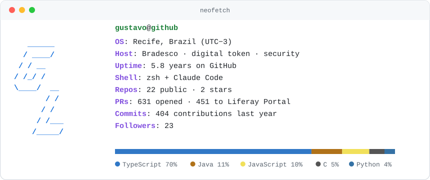

<picture>
  <source media="(prefers-color-scheme: dark)" srcset="assets/terminal-dark.svg">
  
</picture>

<p align="center">
  <a href="https://www.linkedin.com/in/gustavolimav/"></a>
  <a href="mailto:gustavolvma@gmail.com"></a>
</p>

```ts
const gustavo = {
  basedIn: "Recife, Brazil",
  role: "Software Engineer @ Bradesco",
  dayJob: "digital token product · Business-Integrated Security tribe",
  speaks: ["TypeScript", "Java", "SQL"],
  shipsWith: ["Next.js", "React", "Node.js", "Spring", "PostgreSQL", "Supabase", "Vercel"],
  previously: "450+ pull requests to Liferay Portal — mostly the search stack",
  afterHours: "building small, opinionated products end to end — from design to production",
  askMeAbout: ["authentication & security", "search", "full-stack product work", "AI-assisted development"],
};
```

> [!NOTE]
> My day-to-day work at Bradesco lives in a corporate GitHub account, so this graph mostly shows Liferay contributions and side projects.

## `~/projects`

| | Project | What it does | Built with |
|:-:|---|---|---|
|  | **Finanças** <sub>private</sub> | Personal-finance PWA that replaced a 16-month spreadsheet: daily balance projection, spending pace, early warnings before the balance dips and a discreet mode for demos. | Next.js 16 · Supabase · Vercel |
|  | **Casa em Dia** <sub>private</sub> | Rent management for landlords aged 50+ and the family who helps them — big type, one task per screen, ready-to-send WhatsApp reminders. | Next.js · Supabase |
|  | **Nossa Lista** <sub>private</sub> | Wedding gift registry SaaS: guests give via Pix or card, and partner venues earn a share for every couple they refer. | Next.js · TypeScript · payments |
|  | [**papershare**](https://github.com/gustavolimav/papershare) | Open-source DocSend/Papermark-style document sharing with link analytics and bring-your-own-key AI summaries. | Next.js 14 · PostgreSQL · S3 |
|  | [**template-project**](https://github.com/gustavolimav/template-project) | AI-first iOS app monorepo with real auth (Apple, Google), LGPD compliance and full tooling. | Turborepo · Expo 52 · Next.js 15 · Supabase |
|  | [**Restaurant-Marketplace**](https://github.com/gustavolimav/Restaurant-Marketplace-desafio) | Marketplace catalog API with async processing on AWS. | Java · Spring · SQS · S3 · MongoDB |
|  | [**iot-esp32**](https://github.com/gustavolimav/iot-esp32-controle-de-acesso) | Access control with an ESP32 microcontroller. | C++ · Python |

## `~/stack`


## `~/stats`

<picture>
  <source media="(prefers-color-scheme: dark)" srcset="assets/neofetch-dark.svg">
  
</picture>

<sub>Generated daily from public GitHub data by a workflow in this repo — no third-party stats service.</sub>

## `~/contact`

```bash
$ ping gustavo   # open to good conversations about security, search and product engineering
```

<p>
  <a href="https://www.linkedin.com/in/gustavolimav/"></a>
  <a href="mailto:gustavolvma@gmail.com"></a>
  <a href="https://github.com/gustavolimav"></a>
</p>

<sub>`exit 0` — thanks for stopping by.</sub>
